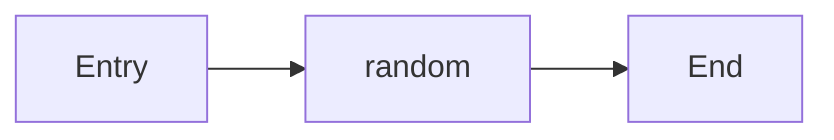
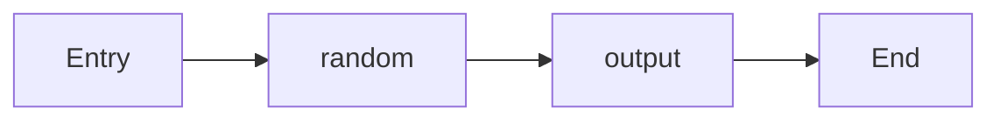
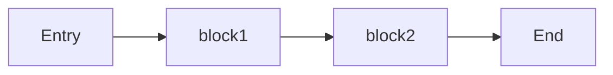
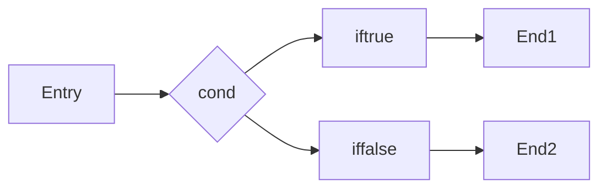
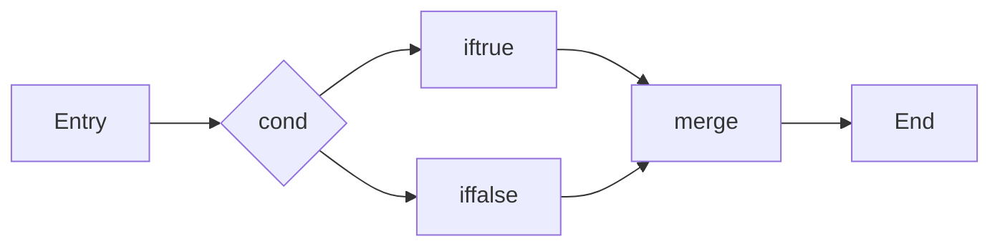
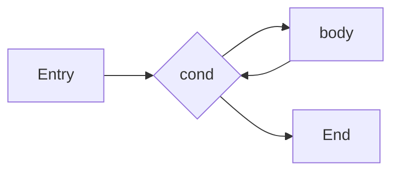

# 0x09 HAM 神谕与编译

HAM 的编译过程是一个 monad 值被求解并转换为目标程序的过程。编译过程本身是一个神谕，编译器在编译时会调用系统调用来完成编译。

我们可以认为 monad 值就是目标程序的等价物，在编译时，指定某个 manad 值或者 monad 表达式作为“入口”，编译器会把这个 monad 值求解并转换为目标程序。一般情况下，我们用程序框图来表示 monad 值的内容。

例如：

```HAM
os // empty monad 值
```


当我们把 monad 值传入 monad 函数时，monad 函数会返回一个新的 monad 值，这个新的 monad 值的内容是原来的 monad 值经过函数处理后的结果。

```HAM
os = os |> random,        // 请求一个随机值
```



monad 值也可以像组合一样使用。

```HAM
x = os.random
os = os |> output("hi ${x}\n")
// 此处 output 函数的定义是一个柯里化的函数，返回一个 monad 值
/**
 * output = (msg) => (os) => 
 *   返回新的 monad 值 (添加输出 msg 的节点)
 */
```



> 这里绘制的是简化的流程图，实际上任何值的产生都是需要神谕的，甚至是一个简单的值 `1`，在编译时也需要神谕来产生。

## LLVM IR

monad 值编译后会被转换为 LLVM IR，LLVM IR 是一种中间表示语言，具有跨平台的特性。LLVM IR 可以被进一步编译为目标平台的机器码。

HAM 中的 monad 节点可以被认为是 LLVM IR 中的基本块（Basic Block），每个基本块包含一系列指令，这些指令在执行时会产生副作用或者返回值。

与 LLVM IR 不同的是，HAM 的 monad 基本块是通过表达式规约得到的，而 LLVM IR 的基本块需要手动编写。

为了更好地说明 monad 函数的特点，我们先来看看 LLVM IR 中的控制流。

### 顺序结构

LLVM IR 的顺序结构是最基本的控制流结构，它表示一系列指令按顺序执行。每个基本块都有一个入口和一个出口，指令从入口开始执行，直到遇到出口。

```llvm
; 顺序结构示例
entry:
  %1 = add i32 1, 2
  %2 = mul i32 %1, 3
  ret i32 %2
```

多个基本块串起来也是顺序结构，只要它们之间没有分支跳转。

```llvm
; 多个基本块的顺序结构示例
entry:
  br label %block1
block1:
  %1 = add i32 1, 2
  br label %block2
block2:
  %2 = mul i32 %1, 3
  ret i32 %2
```



### 分支结构

LLVM IR 的分支结构允许根据条件跳转到不同的基本块。分支结构通常由条件判断和两个或多个基本块组成。

```llvm
; 分支结构示例
entry:
  %cond = icmp eq i32 %x, 0
  br i1 %cond, label %iftrue, label %iffalse
iftrue:
  ; 条件为真时执行的指令
  ret i32 1
iffalse:
  ; 条件为假时执行的指令
  ret i32 0
```



### 合并控制流

LLVM IR 通过 `phi` 指令来合并不同分支的控制流。`phi` 指令根据控制流的来源选择一个值。

```llvm
; 合并控制流示例
entry:
  %cond = icmp eq i32 %x, 0
  br i1 %cond, label %iftrue, label %iffalse
iftrue:
  %val1 = add i32 1, 2
  br label %merge
iffalse:
  %val2 = mul i32 3, 4
  br label %merge
merge:
  %result = phi i32 [ %val1, %iftrue ], [ %val2, %iffalse ]
  ret i32 %result
```

`phi` 指令位于一个基本块的开头，它根据控制流的来源选择一个值。在上面的示例中，`%result` 的值取决于控制流是从 `iftrue` 还是 `iffalse` 分支进入 `merge` 块。



### 循环结构

有了分支结构和合并控制流，我们就可以构建循环结构。循环结构通常由一个条件判断和一个或多个基本块组成。

```llvm
; 循环结构示例
entry:
  br label %loop
loop:
  %cond = icmp slt i32 %i, 10
  br i1 %cond, label %body, label %end
body:
  ; 循环体的指令
  %i_next = add i32 %i, 1
  br label %loop
end:
  ret void
```



## monad 函数与 LLVM IR 的映射

monad 函数在 HAM 中是一个特殊的函数，它接受一个或多个 monad 值作为输入，并返回一个或多个新的 monad 值。monad 函数的调用会生成一个新的基本块，这个基本块包含了函数体内的指令。

与 LLVM IR 的基本块不同，monad 函数可以返回多种 monad 值，这是因为 HAM 中允许将多个函数用 delta 运算符组合在一起，形成一个新的 monad 函数。

分支结构的 monad 函数则会直接返回两种不同的 monad 值，分别对应于条件为真和条件为假的情况。合并控制流的 monad 函数则会组装一个新的 monad 值，这个值包含了来自不同分支的结果。

## 隐藏的 monad 函数

所有 HAM 的基本语法最终都是通过 monad 函数来实现的。即使是看似普通的函数调用，也会被编译器转换为 monad 函数的调用。

又因为编译器最终会选择一个 monad 值作为入口进行编译，所以所有的函数调用最终都会被转换为 monad 函数的调用。